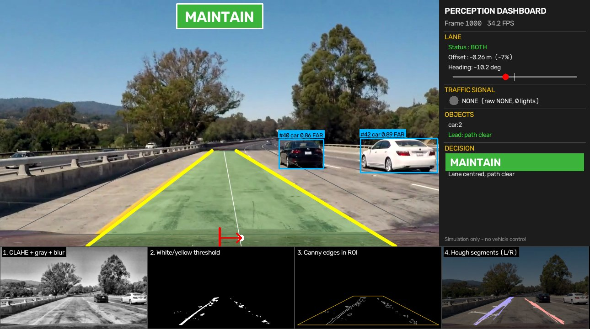
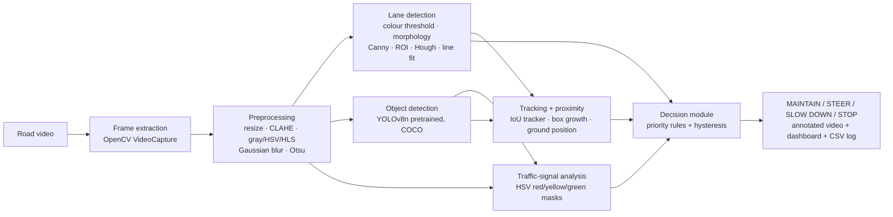
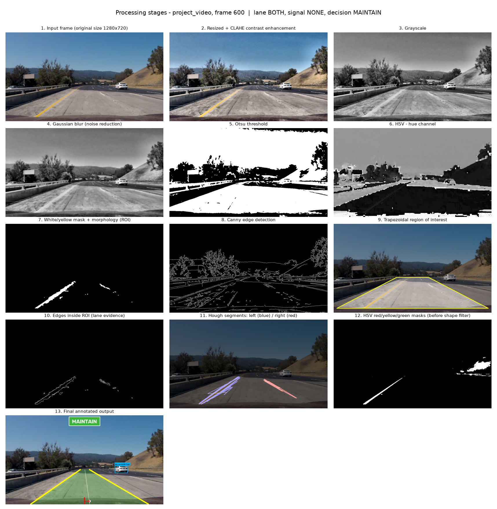
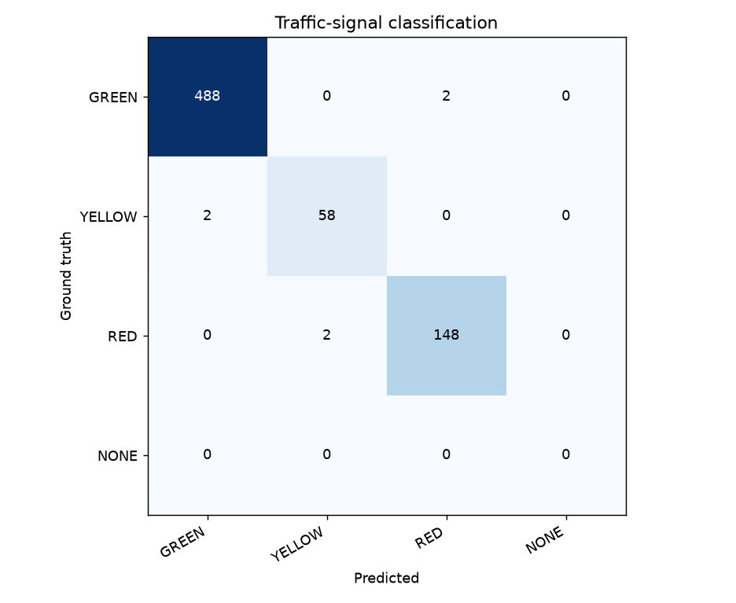

# Vision-Based Autonomous Driving Perception and Lane Guidance System

**IPCV Lab Project, Department of CSE & IT, Jaypee Institute of Information Technology, Noida**

| Name | Roll Number | Batch |
|---|---|---|
| Lavesh Goyal | 2401200061 | G2 |
| Mehak Gupta | 2401200034 | G2 |
| Navya Sachdeva | 2401200037 | G2 |

Submitted to: Dr. Neha, Dr. Pawan Kumar Upadhyay, Dr. Sukrati Jain

---

A perception prototype that processes prerecorded road video and produces **lane boundaries**, **road-object detections with tracking and proximity**, **traffic-light states**, and a **simulated driving recommendation**: `MAINTAIN`, `STEER LEFT/RIGHT`, `SLOW DOWN` or `STOP`. Classical image processing (filtering, enhancement, thresholding, morphology, Canny, ROI, Hough, HSV segmentation) forms the core of the system. A pretrained YOLO detector handles object detection.

> Academic prototype for demonstrating perception concepts. It does not control a vehicle.



## System architecture



| Synopsis objective | Implementation |
|---|---|
| A. Acquire and process frames with Python + OpenCV | [src/pipeline.py](src/pipeline.py): `run_video`, `PerceptionPipeline` |
| B. Resizing, colour conversion, filtering, enhancement, thresholding, edge detection | [src/preprocessing.py](src/preprocessing.py) |
| C. Lane boundaries + lane centre via ROI and line detection | [src/lane_detection.py](src/lane_detection.py) |
| D. Detect cars, motorcycles, buses, trucks, pedestrians | [src/object_detection.py](src/object_detection.py) (YOLOv8n) |
| E. Traffic-light state via colour-based processing | [src/traffic_light.py](src/traffic_light.py) |
| F. Track objects across frames + relative proximity | [src/tracking.py](src/tracking.py) |
| G. Decision module + evaluation | [src/decision.py](src/decision.py), [scripts/evaluate.py](scripts/evaluate.py) |

## Methodology

1. **Input and frame extraction.** Frames are read with `cv2.VideoCapture` from a video file or a webcam index.
2. **Preprocessing.** Each frame is resized to 960 px wide with the aspect ratio kept. CLAHE runs on the L channel of LAB to recover faded paint and shadowed areas. The frame is then converted to grayscale, smoothed with a Gaussian (or median) blur, and Otsu-thresholded. HSV and HLS copies are kept for colour segmentation.
3. **Lane detection.**
   - White paint is selected by an adaptive HLS-lightness threshold (the 97th percentile of the road ROI). Yellow paint is selected by an HSV range.
   - Morphological opening removes speckles and closing fills gaps in the paint.
   - Canny edges are kept near lane-coloured pixels. If the colour mask finds almost nothing, plain Canny is used instead.
   - The edges are restricted to a trapezoidal ROI, and the probabilistic Hough transform (`HoughLinesP`) extracts line segments.
   - Segments are split into left (negative slope) and right (positive slope) sets. Each set gets a length-weighted least-squares fit `x = a·y + b`.
   - Sanity checks reject a fit if the lane width is implausible, the two lines don't converge to a vanishing point, or a line jumps suddenly between frames.
   - An exponential moving average smooths the lines, and a short memory keeps the last good lane for up to 12 frames. If one side is missing, it is inferred from the learned lane width.
   - The lane centre and the camera centre give the lateral offset in pixels, in metres (assuming a 3.7 m lane), and as a fraction of lane width.
4. **Traffic-signal analysis.** HSV masks are built for lit red (two hue bands), yellow and green lamps. A light's state is the colour with the highest lit-pixel ratio inside its box. For tall housings where colour is ambiguous, the position of the brightest third (top, middle or bottom) is used as a fallback. Lights are located in two ways:
   - **YOLO** "traffic light" boxes. This is the default.
   - **Pure image processing** (`--signal-mode hsv`/`both`). The search looks for bright, saturated blobs in the upper part of the frame that are round (circularity ≥ 0.65 and enclosing-circle fill ≥ 0.70, which rejects diamond road signs). Each blob must sit in a dark housing that extends above, below or beside the lamp, and must not lie inside a detected vehicle (to ignore brake lights).

   A majority vote over the last 5 frames removes flicker.
5. **Object detection.** Pretrained YOLOv8n (COCO) runs on MPS, CUDA or CPU. It is restricted to road classes: person, bicycle, car, motorcycle, bus, truck, traffic light and stop sign.
6. **Tracking and proximity.**
   - A greedy IoU tracker assigns persistent IDs. It falls back to centroid distance for fast-moving objects and treats car, truck and bus labels as compatible to cope with label flicker.
   - **Proximity** (0 = horizon, 1 = bumper) is the larger of two cues: how low the box base sits between the horizon and the bottom of the frame (flat-road assumption), and the box's apparent height. It maps to FAR, MEDIUM or NEAR.
   - **Approaching** is set when the box height grows more than 1.5% per frame.
   - **In-path** means the object's base lies inside the detected lane corridor, or inside a widening central corridor when no lane is visible.
   - These are relative cues, not metric distances.
7. **Decision module.** The rules are applied in priority order, and the first match wins:

   | # | Condition | Action |
   |---|---|---|
   | 1 | Red signal | STOP |
   | 2 | In-path obstacle with proximity ≥ 0.80, or a pedestrian in path at medium range | STOP |
   | 3 | Yellow signal | SLOW DOWN |
   | 4 | In-path obstacle NEAR, or MEDIUM and approaching | SLOW DOWN |
   | 5 | Lane markings lost for 30+ frames | SLOW DOWN |
   | 6 | \|lane offset\| > 15% of lane width | STEER LEFT / RIGHT |
   | 7 | Otherwise | MAINTAIN |

   **Hysteresis:** a more severe action takes effect immediately (safety first). Relaxing to a calmer action requires it to persist for 4 frames. This removes single-frame flicker.

### Processing stages (`scripts/visualize_stages.py`)



## Results

All runs below are on a MacBook (Apple Silicon, YOLO on MPS) at 960×540 processing resolution. The metrics come from `scripts/evaluate.py`.

| Video | Frames | Lane detected | Both lines fresh | Offset jitter (lane-widths/frame) | Objects/frame | Mean det. conf. | Tracks (mean length) | Speed |
|---|---|---|---|---|---|---|---|---|
| solidWhiteRight (highway) | 221 | 100% | 100% | 0.0011 | 3.35 | 0.60 | 21 (33.7 f) | 31 ms · 32 FPS |
| solidYellowLeft (highway, yellow line) | 681 | 100% | 100% | 0.0010 | 1.39 | 0.55 | 48 (18.2 f) | 31 ms · 32 FPS |
| project_video (concrete, shadows, curves) | 1260 | 100% | 98.6% | 0.0015 | 1.53 | 0.79 | 44 (42.2 f) | 36 ms · 27 FPS |
| challenge_video (bridge shadow, cracks, pitched camera) | 484 | 100% | 96.1% | 0.0043 | 2.75 | 0.66 | 72 (17.3 f) | 37 ms · 27 FPS |

**False traffic-signal detections on all four real clips** (with the HSV blob search enabled, `--signal-mode both`): **0 frames**.

### Ground-truth evaluation (synthetic video)

The public clips contain no traffic lights and no close obstacles in the ego lane, so `scripts/generate_synthetic_video.py` renders a 700-frame road scene with known ground truth. The scene includes lateral drift left and right, a GREEN → YELLOW → RED → GREEN light cycle, moving shadows and sensor noise.

| Metric | Result |
|---|---|
| Traffic-signal classification accuracy | **99.1%** (YOLO+HSV and HSV-only both) |
| Driving-decision accuracy | **96.1%** |
| Decision recall: STOP / SLOW DOWN / STEER L / STEER R / MAINTAIN | 98.7% / 96.7% / 97.2% / 97.2% / 93.8% |
| Lateral offset mean absolute error | 0.006 lane widths (≈ 2 cm) |

All remaining errors are 1–4 frame delays at state transitions, which come from the deliberate temporal smoothing and hysteresis. The obstacle-based rules (SLOW DOWN/STOP for vehicles and pedestrians) are covered by unit tests in [tests/test_pipeline.py](tests/test_pipeline.py).

| STEER LEFT (drift right) | SLOW DOWN (yellow) | STOP (red) |
|---|---|---|
|  |  |  |


| Signal confusion matrix | Decision confusion matrix |
|---|---|
|  |  |

Challenge video, driving under a bridge in hard shadow:


## Project structure

```
autonomous-driving-perception/
├── main.py                      # command-line entry point
├── src/
│   ├── config.py                # every tunable threshold in one place
│   ├── preprocessing.py         # stage 2: resize, CLAHE, gray/HSV/HLS, blur, Otsu
│   ├── lane_detection.py        # stage 3: colour masks, Canny, ROI, Hough, fitting, smoothing
│   ├── traffic_light.py         # stage 4: HSV signal classification + blob search
│   ├── object_detection.py      # stage 5: YOLO wrapper
│   ├── tracking.py              # stage 6: IoU tracker, proximity, approach, in-path
│   ├── decision.py              # stage 7: rules + hysteresis
│   ├── visualization.py         # annotated frame + dashboard
│   └── pipeline.py              # glue: per-frame processing, video I/O, CSV logging
├── scripts/
│   ├── download_samples.py      # fetch public test videos into data/
│   ├── generate_synthetic_video.py  # synthetic road video + ground truth CSV
│   ├── evaluate.py              # metrics, plots, confusion matrices
│   └── visualize_stages.py      # all processing stages for one frame (report figure)
├── notebooks/demo.ipynb         # step-by-step walkthrough with outputs
├── tests/test_pipeline.py       # 18 unit tests covering every stage
├── docs/images/                 # figures used in this README
├── data/                        # input videos (not committed)
├── models/                      # YOLO weights, downloaded automatically (not committed)
└── outputs/                     # annotated videos, logs, evaluation (not committed)
```

## Setup

Requires Python 3.9 or newer (tested with 3.12).

```bash
git clone https://github.com/<your-username>/autonomous-driving-perception.git
cd autonomous-driving-perception
python3 -m venv .venv
source .venv/bin/activate          # Windows: .venv\Scripts\activate
pip install -r requirements.txt

python scripts/download_samples.py          # 4 public road videos (~44 MB) -> data/
python scripts/generate_synthetic_video.py  # synthetic video + ground truth -> data/
```

The YOLOv8n weights (6 MB) are downloaded to `models/` automatically on the first run.

## Usage

```bash
# full pipeline -> outputs/<name>_annotated.mp4 and outputs/<name>_log.csv
python main.py --input data/project_video.mp4

# live window (q = quit, space = pause)
python main.py --input data/challenge_video.mp4 --show

# synthetic video with the pure image-processing traffic-light search too
python main.py --input data/synthetic_road.mp4 --signal-mode both

# no deep learning at all (classical CV only)
python main.py --input data/synthetic_road.mp4 --no-yolo

# your own dashcam clip, or a webcam
python main.py --input path/to/dashcam.mp4 --snapshots 100
python main.py --input 0 --show

# evaluation
python scripts/evaluate.py --log outputs/project_video_log.csv
python scripts/evaluate.py --log outputs/synthetic_road_log.csv --gt data/synthetic_road_gt.csv

# report figure with every processing stage
python scripts/visualize_stages.py --input data/project_video.mp4 --frame 600

# tests and notebook
python -m pytest -q
jupyter notebook notebooks/demo.ipynb
```

Main options: `--model yolov8s.pt` (larger, more accurate model), `--device cpu|mps|cuda`, `--conf 0.35`, `--width 960`, `--max-frames N`, `--snapshots N` (save a dashboard JPEG every N frames). All thresholds are in [src/config.py](src/config.py).

## Limitations

- Lanes are modelled as straight lines, so sharp curves are approximated by their near-field tangent.
- The offset assumes the camera is mounted at the vehicle centre. Metric values assume a 3.7 m lane and are approximate.
- Proximity is a relative cue based on box position and size, not a calibrated distance.
- The pure-HSV traffic-light search can be fooled by round, lit, saturated objects in dark surroundings. In the default mode, YOLO locates lights and HSV only classifies them.
- Night, rain and missing lane markings were not part of the test set.

## Future scope

Drivable-area segmentation, polynomial/bird's-eye-view lane fitting for curves, stronger multi-object tracking (Kalman filter + Hungarian matching, e.g. SORT/ByteTrack), camera calibration, monocular depth estimation, traffic-sign recognition, adverse-weather preprocessing, and integration with a driving simulator such as CARLA.

## Acknowledgements

- Test videos: Udacity Self-Driving Car Nanodegree ([CarND-LaneLines-P1](https://github.com/udacity/CarND-LaneLines-P1), [CarND-Advanced-Lane-Lines](https://github.com/udacity/CarND-Advanced-Lane-Lines)), MIT licence.
- Object detection: [Ultralytics YOLOv8](https://github.com/ultralytics/ultralytics), pretrained on COCO.
