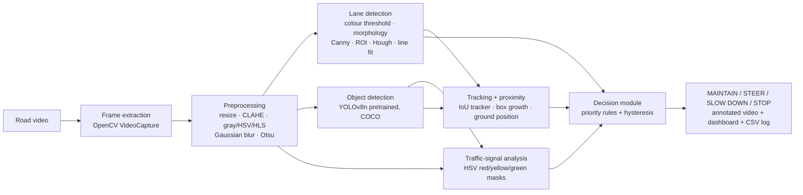
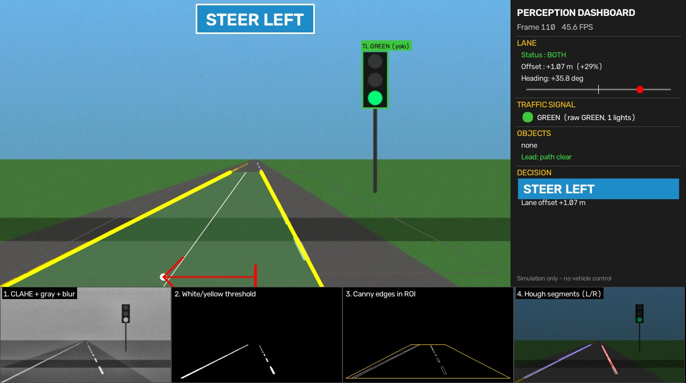
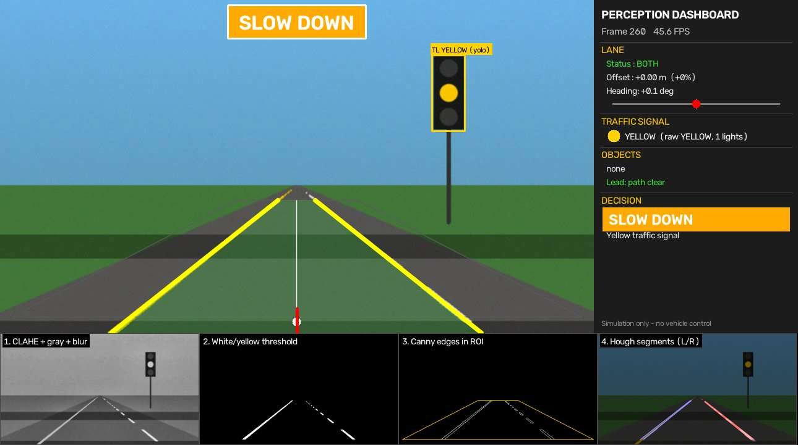
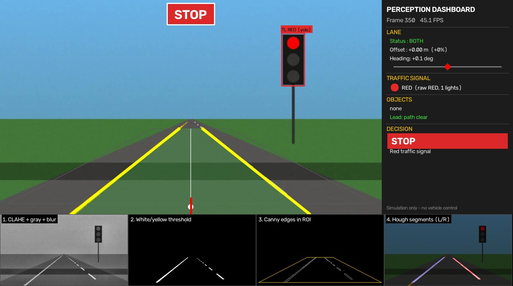
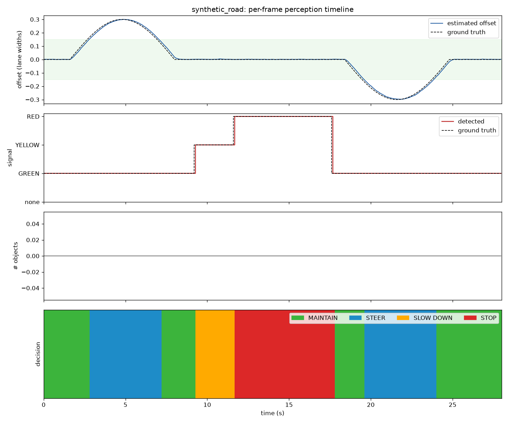
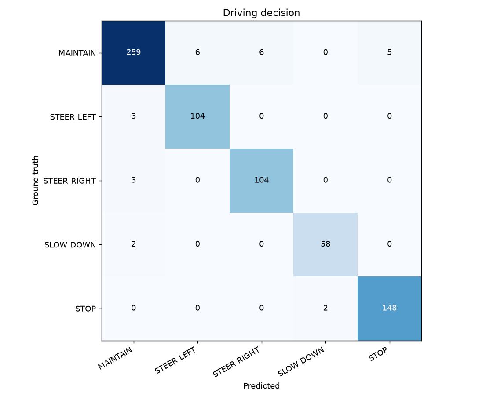
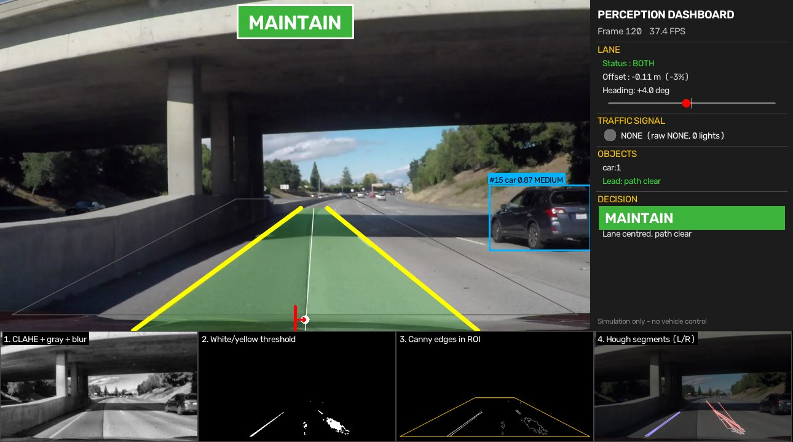

# Vision-Based Autonomous Driving Perception and Lane Guidance System

**IPCV Lab Project, Department of CSE & IT, Jaypee Institute of Information Technology, Noida**

| Name | Roll Number | Batch |
|---|---|---|
| Lavesh Goyal | 2401200061 | G2 |
| Mehak Gupta | 2401200034 | G2 |
| Navya Sachdeva | 2401200037 | G2 |

Submitted to: Dr. Neha, Dr. Pawan Kumar Upadhyay, Dr. Sukrati Jain

---

A perception prototype that processes prerecorded road video and produces **lane boundaries**, **road-object detections with tracking and proximity**, **traffic-light states**, and a **simulated driving recommendation**: `MAINTAIN`, `STEER LEFT/RIGHT`, `SLOW DOWN` or `STOP`. Classical image processing (filtering, enhancement, thresholding, morphology, Canny, ROI, Hough, HSV segmentation) forms the core of the system. A pretrained YOLO detector handles object detection.

> Academic prototype for demonstrating perception concepts. It does not control a vehicle.


## System architecture



| Synopsis objective | Implementation |
|---|---|
| A. Acquire and process frames with Python + OpenCV | [src/pipeline.py](src/pipeline.py): `run_video`, `PerceptionPipeline` |
| B. Resizing, colour conversion, filtering, enhancement, thresholding, edge detection | [src/preprocessing.py](src/preprocessing.py) |
| C. Lane boundaries + lane centre via ROI and line detection | [src/lane_detection.py](src/lane_detection.py) |
| D. Detect cars, motorcycles, buses, trucks, pedestrians | [src/object_detection.py](src/object_detection.py) (YOLOv8n) |
| E. Traffic-light state via colour-based processing | [src/traffic_light.py](src/traffic_light.py) |
| F. Track objects across frames + relative proximity | [src/tracking.py](src/tracking.py) |
| G. Decision module + evaluation | [src/decision.py](src/decision.py), [scripts/evaluate.py](scripts/evaluate.py) |

## Methodology

1. **Input and frame extraction.** Frames are read with `cv2.VideoCapture` from a video file or a webcam index.
2. **Preprocessing.** Each frame is resized to 960 px wide with the aspect ratio kept. CLAHE runs on the L channel of LAB to recover faded paint and shadowed areas. The frame is then converted to grayscale, smoothed with a Gaussian (or median) blur, and Otsu-thresholded. HSV and HLS copies are kept for colour segmentation.
3. **Lane detection.**
   - White paint is selected by an adaptive HLS-lightness threshold (the 97th percentile of the road ROI). Yellow paint is selected by an HSV range.
   - Morphological opening removes speckles and closing fills gaps in the paint.
   - Canny edges are kept near lane-coloured pixels. If the colour mask finds almost nothing, plain Canny is used instead.
   - The edges are restricted to a trapezoidal ROI, and the probabilistic Hough transform (`HoughLinesP`) extracts line segments.
   - Segments are split into left (negative slope) and right (positive slope) sets. Each set gets a length-weighted least-squares fit `x = a·y + b`.
   - Sanity checks reject a fit if the lane width is implausible, the two lines don't converge to a vanishing point, or a line jumps suddenly between frames.
   - An exponential moving average smooths the lines, and a short memory keeps the last good lane for up to 12 frames. If one side is missing, it is inferred from the learned lane width.
   - The lane centre and the camera centre give the lateral offset in pixels, in metres (assuming a 3.7 m lane), and as a fraction of lane width.
4. **Traffic-signal analysis.** HSV masks are built for lit red (two hue bands), yellow and green lamps. A light's state is the colour with the highest lit-pixel ratio inside its box. For tall housings where colour is ambiguous, the position of the brightest third (top, middle or bottom) is used as a fallback. Lights are located in two ways:
   - **YOLO** "traffic light" boxes. This is the default.
   - **Pure image processing** (`--signal-mode hsv`/`both`). The search looks for bright, saturated blobs in the upper part of the frame that are round (circularity ≥ 0.65 and enclosing-circle fill ≥ 0.70, which rejects diamond road signs). Each blob must sit in a dark housing that extends above, below or beside the lamp, and must not lie inside a detected vehicle (to ignore brake lights).

   A majority vote over the last 5 frames removes flicker.
5. **Object detection.** Pretrained YOLOv8n (COCO) runs on MPS, CUDA or CPU. It is restricted to road classes: person, bicycle, car, motorcycle, bus, truck, traffic light and stop sign.
6. **Tracking and proximity.**
   - A greedy IoU tracker assigns persistent IDs. It falls back to centroid distance for fast-moving objects and treats car, truck and bus labels as compatible to cope with label flicker.
   - **Proximity** (0 = horizon, 1 = bumper) is the larger of two cues: how low the box base sits between the horizon and the bottom of the frame (flat-road assumption), and the box's apparent height. It maps to FAR, MEDIUM or NEAR.
   - **Approaching** is set when the box height grows more than 1.5% per frame.
   - **In-path** means the object's base lies inside the detected lane corridor, or inside a widening central corridor when no lane is visible.
   - These are relative cues, not metric distances.
7. **Decision module.** The rules are applied in priority order, and the first match wins:

   | # | Condition | Action |
   |---|---|---|
   | 1 | Red signal | STOP |
   | 2 | In-path obstacle with proximity ≥ 0.80, or a pedestrian in path at medium range | STOP |
   | 3 | Yellow signal | SLOW DOWN |
   | 4 | In-path obstacle NEAR, or MEDIUM and approaching | SLOW DOWN |
   | 5 | Lane markings lost for 30+ frames | SLOW DOWN |
   | 6 | \|lane offset\| > 15% of lane width | STEER LEFT / RIGHT |
   | 7 | Otherwise | MAINTAIN |

   **Hysteresis:** a more severe action takes effect immediately (safety first). Relaxing to a calmer action requires it to persist for 4 frames. This removes single-frame flicker.

### Processing stages (`scripts/visualize_stages.py`)


## Results

All runs below are on a MacBook (Apple Silicon, YOLO on MPS) at 960×540 processing resolution. The metrics come from `scripts/evaluate.py`.

| Video | Frames | Lane detected | Both lines fresh | Offset jitter (lane-widths/frame) | Objects/frame | Mean det. conf. | Tracks (mean length) | Speed |
|---|---|---|---|---|---|---|---|---|
| solidWhiteRight (highway) | 221 | 100% | 100% | 0.0011 | 3.35 | 0.60 | 21 (33.7 f) | 31 ms · 32 FPS |
| solidYellowLeft (highway, yellow line) | 681 | 100% | 100% | 0.0010 | 1.39 | 0.55 | 48 (18.2 f) | 31 ms · 32 FPS |
| project_video (concrete, shadows, curves) | 1260 | 100% | 98.6% | 0.0015 | 1.53 | 0.79 | 44 (42.2 f) | 36 ms · 27 FPS |
| challenge_video (bridge shadow, cracks, pitched camera) | 484 | 100% | 96.1% | 0.0043 | 2.75 | 0.66 | 72 (17.3 f) | 37 ms · 27 FPS |

**False traffic-signal detections on all four real clips** (with the HSV blob search enabled, `--signal-mode both`): **0 frames**.

### Ground-truth evaluation (synthetic video)

The public clips contain no traffic lights and no close obstacles in the ego lane, so `scripts/generate_synthetic_video.py` renders a 700-frame road scene with known ground truth. The scene includes lateral drift left and right, a GREEN → YELLOW → RED → GREEN light cycle, moving shadows and sensor noise.

| Metric | Result |
|---|---|
| Traffic-signal classification accuracy | **99.1%** (YOLO+HSV and HSV-only both) |
| Driving-decision accuracy | **96.1%** |
| Decision recall: STOP / SLOW DOWN / STEER L / STEER R / MAINTAIN | 98.7% / 96.7% / 97.2% / 97.2% / 93.8% |
| Lateral offset mean absolute error | 0.006 lane widths (≈ 2 cm) |

All remaining errors are 1–4 frame delays at state transitions, which come from the deliberate temporal smoothing and hysteresis. The obstacle-based rules (SLOW DOWN/STOP for vehicles and pedestrians) are covered by unit tests in [tests/test_pipeline.py](tests/test_pipeline.py).

| STEER LEFT (drift right) | SLOW DOWN (yellow) | STOP (red) |
|---|---|---|
|  |  |  |



| Signal confusion matrix | Decision confusion matrix |
|---|---|
|  |  |

Challenge video, driving under a bridge in hard shadow:



## Project structure

```
autonomous-driving-perception/
├── main.py                      # command-line entry point
├── src/
│   ├── config.py                # every tunable threshold in one place
│   ├── preprocessing.py         # stage 2: resize, CLAHE, gray/HSV/HLS, blur, Otsu
│   ├── lane_detection.py        # stage 3: colour masks, Canny, ROI, Hough, fitting, smoothing
│   ├── traffic_light.py         # stage 4: HSV signal classification + blob search
│   ├── object_detection.py      # stage 5: YOLO wrapper
│   ├── tracking.py              # stage 6: IoU tracker, proximity, approach, in-path
│   ├── decision.py              # stage 7: rules + hysteresis
│   ├── visualization.py         # annotated frame + dashboard
│   └── pipeline.py              # glue: per-frame processing, video I/O, CSV logging
├── scripts/
│   ├── download_samples.py      # fetch public test videos into data/
│   ├── generate_synthetic_video.py  # synthetic road video + ground truth CSV
│   ├── evaluate.py              # metrics, plots, confusion matrices
│   └── visualize_stages.py      # all processing stages for one frame (report figure)
├── notebooks/demo.ipynb         # step-by-step walkthrough with outputs
├── tests/test_pipeline.py       # 18 unit tests covering every stage
├── docs/images/                 # figures used in this README
├── data/                        # input videos (not committed)
├── models/                      # YOLO weights, downloaded automatically (not committed)
└── outputs/                     # annotated videos, logs, evaluation (not committed)
```

## Running on another system

### Requirements

| | Minimum | Tested on |
|---|---|---|
| OS | Windows 10/11, macOS 11+, Ubuntu 20.04+ | macOS (Apple Silicon) |
| Python | 3.9 or newer (64-bit) | 3.12 |
| RAM | 4 GB (8 GB recommended) | 8 GB |
| Disk | ~2 GB free (mostly PyTorch) | |
| Internet | Needed once, for installation and downloading videos and weights | |
| GPU | Optional. Uses NVIDIA CUDA or Apple MPS if available, otherwise the CPU | Apple MPS |

To check your Python version, run `python3 --version` (macOS/Linux) or `python --version` (Windows). If Python is missing, install it from [python.org](https://www.python.org/downloads/). On Windows, tick **"Add Python to PATH"** in the installer.

### Step 1: Get the code

With git:

```bash
git clone https://github.com/lavishgoyal7171-spec/autonomous-driving-perception.git
cd autonomous-driving-perception
```

Without git: on the GitHub page, click **Code → Download ZIP**, extract it, and open a terminal inside the extracted folder.

### Step 2: Create a virtual environment and install the libraries

**macOS / Linux**

```bash
python3 -m venv .venv
source .venv/bin/activate
pip install --upgrade pip
pip install -r requirements.txt
```

**Windows (Command Prompt or PowerShell)**

```bat
python -m venv .venv
.venv\Scripts\activate
python -m pip install --upgrade pip
pip install -r requirements.txt
```

The installation takes 3–10 minutes, because PyTorch is large. When it finishes, your prompt starts with `(.venv)`. **Run the activate command again every time you open a new terminal.**

### Step 3: Download the test videos and create the synthetic video

```bash
python scripts/download_samples.py          # 4 public road videos (~44 MB) -> data/
python scripts/generate_synthetic_video.py  # synthetic video + ground truth -> data/
```

### Step 4: Check the installation

```bash
python -m pytest -q
```

You should see `18 passed`.

### Step 5: Run

```bash
python main.py -i data/challenge_video.mp4 --show                     # real road, live window
python main.py -i data/synthetic_road.mp4 --signal-mode both --show   # traffic light + all decisions
```

On the first run, the YOLOv8n weights (6 MB) are downloaded to `models/` automatically. In the window, press **space** to pause and **q** to quit. The annotated video and the CSV log are saved in `outputs/`.

### Running without internet (e.g. a lab PC)

1. Do steps 1–3 on a machine that has internet access.
2. Copy the whole project folder to the lab PC with a USB drive. Include `data/` and `models/`, but leave out `.venv/`.
3. On the lab PC, the libraries still have to be installed (step 2). If it has no internet at all, download them on the first machine with `pip download -r requirements.txt -d wheels/`, copy the `wheels/` folder over too, and install with `pip install --no-index --find-links wheels -r requirements.txt`. Both machines must use the same OS and Python version for this to work.

### Troubleshooting

| Problem | Fix |
|---|---|
| `command not found: python` (macOS/Linux) | Use `python3` instead, or activate the virtual environment first |
| `'python' is not recognized` (Windows) | Reinstall Python with "Add Python to PATH" ticked, or use `py` instead of `python` |
| PowerShell: "running scripts is disabled" when activating | Run `Set-ExecutionPolicy -Scope CurrentUser RemoteSigned` once, or use Command Prompt |
| `ModuleNotFoundError: No module named 'cv2'` / `'ultralytics'` | The virtual environment isn't active. Run the activate command from step 2 |
| `Cannot open video source` | Check the path. Run step 3, or list the folder with `ls data` (Windows: `dir data`) |
| `ImportError: libGL.so.1` (Linux) | `sudo apt install libgl1 libglib2.0-0` |
| No window appears / `cannot connect to X server` (remote or SSH machine) | Leave out `--show`. The annotated video is still written to `outputs/` |
| Very slow (under 5 FPS) on an old laptop | Add `--width 640`, or `--no-yolo` for classical CV only |
| CUDA / MPS errors | Force the CPU with `--device cpu` |
| Webcam not opening | Try `-i 1` instead of `-i 0`. On macOS, allow camera access for the terminal in System Settings → Privacy |
| YOLO weights download fails (proxy/firewall) | Download `yolov8n.pt` from the [Ultralytics releases](https://github.com/ultralytics/assets/releases) and place it in `models/` |

## Usage

```bash
# full pipeline -> outputs/<name>_annotated.mp4 and outputs/<name>_log.csv
python main.py --input data/project_video.mp4

# live window (q = quit, space = pause)
python main.py --input data/challenge_video.mp4 --show

# synthetic video with the pure image-processing traffic-light search too
python main.py --input data/synthetic_road.mp4 --signal-mode both

# no deep learning at all (classical CV only)
python main.py --input data/synthetic_road.mp4 --no-yolo

# your own dashcam clip, or a webcam
python main.py --input path/to/dashcam.mp4 --snapshots 100
python main.py --input 0 --show

# evaluation
python scripts/evaluate.py --log outputs/project_video_log.csv
python scripts/evaluate.py --log outputs/synthetic_road_log.csv --gt data/synthetic_road_gt.csv

# report figure with every processing stage
python scripts/visualize_stages.py --input data/project_video.mp4 --frame 600

# tests and notebook
python -m pytest -q
jupyter notebook notebooks/demo.ipynb
```

Main options: `--model yolov8s.pt` (larger, more accurate model), `--device cpu|mps|cuda`, `--conf 0.35`, `--width 960`, `--max-frames N`, `--snapshots N` (save a dashboard JPEG every N frames). All thresholds are in [src/config.py](src/config.py).

## Live demo procedure

1. Activate the environment (step 2 above) and do one trial run beforehand, so the model is already downloaded and loaded.
2. Open [docs/images/stages_project_video.png](docs/images/stages_project_video.png) and walk through the processing stages, from preprocessing through Canny and the ROI to Hough.
3. Run `python main.py -i data/challenge_video.mp4 --show` to show lane detection, YOLO boxes with track IDs and proximity, the live processing strip, and the dashboard. Press space to pause on interesting frames.
4. Run `python main.py -i data/synthetic_road.mp4 --signal-mode both --show` to show every decision: STEER LEFT → SLOW DOWN (yellow) → STOP (red) → MAINTAIN → STEER RIGHT.
5. Run `python scripts/evaluate.py --log outputs/synthetic_road_log.csv --gt data/synthetic_road_gt.csv` to show the measured accuracy, then open `outputs/eval/synthetic_road/timeline.png`.
6. Optional extras: `--no-yolo` (classical CV only), `-i 0 --show` (webcam), `python -m pytest -q` (tests).

Backup: if anything fails live, play the pre-rendered videos from `outputs/`.

## Expected viva questions

### Overview

**Q1. What does your project do?**
It processes a road video frame by frame and detects the ego lane, road objects (vehicles and pedestrians) and traffic-light states. It tracks objects across frames, estimates their relative proximity, and combines everything in a rule-based decision module that outputs MAINTAIN, STEER LEFT/RIGHT, SLOW DOWN or STOP. It is a perception prototype and a simulation; it does not control a vehicle.

**Q2. Which parts are classical image processing and which are deep learning?**
Everything except object detection is classical: resizing, CLAHE, colour-space conversion, Gaussian blur, Otsu thresholding, HSV/HLS colour segmentation, morphology, Canny, ROI masking, the Hough transform, line fitting, HSV traffic-light classification and contour analysis. Only object detection uses a pretrained deep model (YOLOv8n). With `--no-yolo`, the system runs on classical CV alone.

**Q3. Why combine classical and deep-learning methods?**
Classical methods are fast, interpretable and need no training data. They work well for structured cues such as lane paint and lamp colours. Detecting vehicles and pedestrians in arbitrary poses is much harder to hand-engineer, so a pretrained detector suits that task better.

### Preprocessing

**Q4. Why resize the frames?**
To keep processing time per frame predictable (960 px wide, about 30 ms per frame) and to make pixel thresholds independent of the input resolution. The aspect ratio is preserved.

**Q5. What is CLAHE, and why not use ordinary histogram equalisation?**
Contrast Limited Adaptive Histogram Equalisation equalises small tiles separately and clips the histogram to limit noise amplification. Global equalisation would brighten the sky and wash out the road. CLAHE locally boosts faded lane paint and shadowed areas. It is applied only to the L (lightness) channel of LAB, so the colours are unchanged.

**Q6. Why Gaussian blur before Canny?**
Canny is based on gradients, and noise produces false gradients. A Gaussian low-pass filter suppresses that noise while keeping strong edges. Median blur, which is better against salt-and-pepper noise, is available as an option.

**Q7. Why use HSV/HLS instead of RGB?**
RGB mixes colour and brightness, so a shadow changes all three channels. HSV separates hue (colour) from value (brightness), which makes ranges like "yellow" or "red" robust to illumination. HLS has a lightness channel that is ideal for selecting white paint.

**Q8. Where is thresholding used?**
- An adaptive lightness threshold for white paint (the 97th percentile of the road region).
- HSV range thresholds (`cv2.inRange`) for yellow paint and for the red, yellow and green lamps.
- Otsu's method for a global binary image.
- Hysteresis thresholds inside Canny.

**Q9. What does Otsu's method do?**
It automatically chooses the threshold that minimises the variance within the two pixel classes (equivalently, maximises the variance between them), so no manual threshold is needed.

**Q10. Why use morphological operations?**
Opening (erosion followed by dilation) removes small specks of noise from the colour mask. Closing (dilation followed by erosion) fills small gaps in worn lane paint. Dilation is also used to keep only the Canny edges near lane-coloured pixels.

### Lane detection

**Q11. Explain Canny edge detection.**
1. Gaussian smoothing.
2. Sobel gradients for magnitude and direction.
3. Non-maximum suppression, which thins edges to one pixel.
4. Double thresholding (50/150): strong edges are kept and weak ones are kept only if connected to strong ones (hysteresis).

**Q12. Why a region of interest, and why a trapezoid?**
Lane markings appear only in the lower part of the image, and perspective makes the road look like a trapezoid narrowing towards the horizon. Masking out the sky, trees and other lanes removes most false edges.

**Q13. Explain the Hough transform.**
Each edge pixel votes for every line that could pass through it in (ρ, θ) parameter space, where ρ = x·cosθ + y·sinθ. Peaks in that accumulator are lines. `HoughLinesP` is the probabilistic version: it returns finite segments and uses parameters for minimum line length and maximum gap.

**Q14. How do you separate the left and right lane lines?**
By slope: in image coordinates (y points down), the left line has a negative slope and the right line a positive one. Segments that are nearly horizontal (|slope| < 0.45) or on the wrong side of the image are rejected. All segments on each side are combined with a length-weighted least-squares fit.

**Q15. Why fit x as a function of y (x = a·y + b)?**
Lane lines are close to vertical in the image, where y = mx + c would need a near-infinite slope. Fitting x against y stays numerically stable.

**Q16. How is the lane centre and the offset computed?**
The lane centre is the midpoint of the left and right lines at the bottom row. The camera is assumed to be at the vehicle centre, which is the image centre. The offset is the image centre minus the lane centre. It is converted to metres using a standard lane width of 3.7 m, and expressed as a fraction of the lane width for the steering rule.

**Q17. What happens when a lane line disappears for a few frames?**
Three mechanisms handle it:
- An exponential moving average smooths the lines from frame to frame.
- The last good line is remembered for 12 frames.
- If only one side is visible, the other is rebuilt from the learned lane width.

Sanity checks also reject implausible fits: a wrong lane width, lines that don't converge to a vanishing point, or sudden jumps.

**Q18. What are the limitations of the lane detector?**
It uses a straight-line model, so sharp curves are only approximated. It assumes visible paint and a centred camera. It was not tested at night or in rain. Improvements would be a perspective warp to a bird's-eye view with polynomial (second-order) fitting, or a segmentation network.

### Object detection and tracking

**Q19. What is YOLO, and why YOLOv8n?**
"You Only Look Once" is a single-stage detector: one forward pass predicts bounding boxes, class labels and confidences for the whole image. The "n" (nano) model is the smallest. It runs in real time on a laptop, which matters more here than the last few percent of accuracy. It is pretrained on COCO, which already includes cars, buses, trucks, motorcycles, people and traffic lights, so no training was required.

**Q20. What are confidence and IoU?**
Confidence is the model's score for a detection; we keep detections above 0.35. IoU (Intersection over Union) is the overlap area of two boxes divided by the area of their union. It is used for non-maximum suppression inside YOLO and for matching detections to tracks.

**Q21. How does your tracker work?**
For every frame, IoU is computed between the existing tracks and the new detections, and they are matched greedily, highest IoU first. If IoU is low but the centres are close, it falls back to centroid distance. Unmatched detections start new tracks, and a track is deleted after 8 missed frames. A track must be seen twice before it is shown, which removes one-frame false positives.

**Q22. How do you estimate proximity without depth?**
The ground is assumed to be flat, so objects whose base sits lower in the image are closer. This is combined with the box height relative to the frame. The result is a score from 0 (horizon) to 1 (bumper), mapped to FAR, MEDIUM or NEAR. If the box height grows by more than 1.5% per frame, the object is marked as approaching. These are relative cues, not metres; real distance would need camera calibration, stereo or depth estimation.

**Q23. How do you decide whether an object is in your path?**
The object's bottom-centre point is checked against the detected lane corridor at that image row. If no lane is detected, a central corridor that widens towards the bottom of the image is used instead.

### Traffic signals

**Q24. How are traffic-light colours classified?**
The light's crop is converted to HSV, and masks are built for lit red (two hue bands, because red wraps around 0/180), yellow and green, requiring high saturation and value. The colour with the largest lit-pixel ratio wins. If colour is ambiguous in a tall housing, the brightest third (top, middle or bottom) decides.

**Q25. How do you find traffic lights without YOLO?**
Bright, saturated blobs in the upper part of the frame are kept only if:
- they are round (circularity 4πA/P² ≥ 0.65, and they fill at least 70% of their enclosing circle);
- they sit inside a dark housing that extends past the lamp;
- they are not inside a detected vehicle, which excludes brake lights.

The roundness test rejects diamond-shaped yellow road signs; that false positive was found during testing and fixed.

**Q26. How do you avoid flickering signal states?**
A majority vote over the last 5 frames.

### Decision module

**Q27. Explain the decision rules and their priority.**
The rules are checked in order, and the first match wins:
1. Red light → STOP
2. An obstacle very close in the lane, or a pedestrian in the path → STOP
3. Yellow light → SLOW DOWN
4. A near or approaching obstacle in the lane → SLOW DOWN
5. Lane markings lost for 30 frames → SLOW DOWN
6. Lane offset greater than 15% of the lane width → STEER
7. Otherwise → MAINTAIN

Safety-critical rules come first.

**Q28. Why add hysteresis to the decisions?**
Single-frame noise would otherwise make the output flicker. A more severe action (e.g. STOP) is applied immediately for safety, but relaxing to a calmer action requires it to persist for 4 consecutive frames.

**Q29. Why rule-based instead of learned decisions?**
Rules are interpretable, and every decision has a stated reason. They need no driving data and are easy to verify with unit tests. A learned policy would need large labelled driving datasets and would be hard to explain.

### Evaluation

**Q30. How did you evaluate the system?**
- **Real clips (4 Udacity videos):** lane detection rate, frame-to-frame offset jitter as a stability measure, detection confidence, track lengths, false traffic-light detections and speed.
- **Synthetic video with ground truth:** signal accuracy, decision accuracy, confusion matrices and offset error.
- **18 unit tests** covering every stage, including the obstacle rules.

**Q31. Why use a synthetic video?**
The public clips have no traffic lights and no close obstacles, so STOP and SLOW DOWN could not be tested on them. A generated scene gives exact ground truth for every frame.

**Q32. What were your results?**
- 100% lane detection on all four real clips.
- 99.1% signal accuracy and 96.1% decision accuracy on the synthetic video.
- An offset error of about 0.006 lane widths.
- 0 false traffic lights on the real clips.
- About 27–45 frames per second, depending on the video.

The remaining errors are 1–4 frame delays at state changes, caused by the smoothing.

**Q33. Why is decision accuracy lower than signal accuracy?**
The decision module deliberately waits 4 frames before relaxing to a calmer action (hysteresis). Each transition therefore produces a few "late" frames, which is the trade-off for a stable output.

### Practical

**Q34. How fast is it, and what is the bottleneck?**
About 30 ms per frame on an Apple Silicon laptop. YOLO inference takes most of that time: with `--no-yolo`, the classical stages together take about 7 ms per frame.

**Q35. How would you deploy this in a real car?**
- Calibrate the camera (intrinsics and mounting position).
- Use a bird's-eye view for lane fitting, and a proper tracker such as SORT or a Kalman filter.
- Add depth from stereo or radar.
- Run on an embedded GPU (e.g. Jetson) with TensorRT.
- Validate extensively at night and in rain.

Even then, it would be a driver-assistance system, not autonomous control.

**Q36. Where are the parameters, and how would you tune them?**
All thresholds are in [src/config.py](src/config.py). Tune them on representative videos while watching the dashboard's stage strip, then confirm the change with `scripts/evaluate.py`.

## Limitations

- Lanes are modelled as straight lines, so sharp curves are approximated by their near-field tangent.
- The offset assumes the camera is mounted at the vehicle centre. Metric values assume a 3.7 m lane and are approximate.
- Proximity is a relative cue based on box position and size, not a calibrated distance.
- The pure-HSV traffic-light search can be fooled by round, lit, saturated objects in dark surroundings. In the default mode, YOLO locates lights and HSV only classifies them.
- Night, rain and missing lane markings were not part of the test set.

## Future scope

Drivable-area segmentation, polynomial/bird's-eye-view lane fitting for curves, stronger multi-object tracking (Kalman filter + Hungarian matching, e.g. SORT/ByteTrack), camera calibration, monocular depth estimation, traffic-sign recognition, adverse-weather preprocessing, and integration with a driving simulator such as CARLA.

## Acknowledgements

- Test videos: Udacity Self-Driving Car Nanodegree ([CarND-LaneLines-P1](https://github.com/udacity/CarND-LaneLines-P1), [CarND-Advanced-Lane-Lines](https://github.com/udacity/CarND-Advanced-Lane-Lines)), MIT licence.
- Object detection: [Ultralytics YOLOv8](https://github.com/ultralytics/ultralytics), pretrained on COCO.
